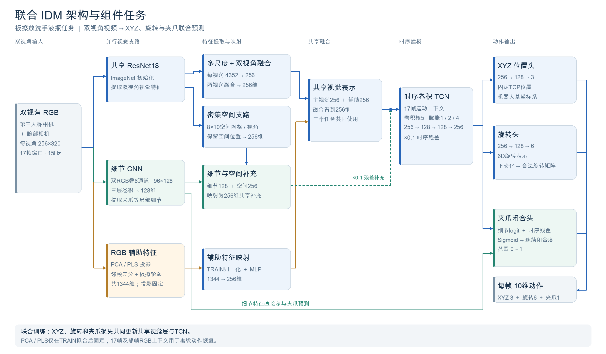

# 双视角联合 IDM：板擦放到洗手液瓶

这是 **2026-10-14 旋转变化约束版** 的代码，对应报告 `板擦洗手液_旋转变化约束对照_50训练10测试_20261014/index.html`。`#eval0004` 是同一模型的第 5 条测试记录。

模型从第三人称与腕部 RGB 视频恢复每帧的 **XYZ、6D 旋转表示、夹爪闭合指令**。三个输出头共享视觉编码与时序特征，联合训练；本版包含相邻帧 SO(3) 旋转变化约束。

## 先看文档

- **[架构详解](docs/ARCHITECTURE.md)**：两个视角如何融合、各组件做什么、action 如何产生。
- **[训练配置与损失](docs/TRAINING.md)**：60 epoch、两张 A100、学习率、旋转变化约束及原实验复现方法。
- **[数据与动作合同](docs/DATA_CONTRACT.md)**：图像布局、10 维动作顺序、TCP、单位与行对齐。
- **[推理使用](docs/INFERENCE.md)**：使用已交付的完整模型包，只输入 RGB。
- **[本版结果](docs/RESULTS.md)**：本版 RAW 指标与最终 10/10 仿真回放结果。



## 架构摘要

```text
第三人称 RGB ─┐  共享 ResNet18 → 两个视角各自映射 → 融合 ─┐
腕部 RGB ─────┘                                         │
双 RGB 的细节 CNN + 空间细节分支 ────────────────────────┤
RGB 的 PCA/PLS/颜色统计辅助特征 ─────────────────────────┤
                                                       ↓
                                              共享 256 维逐帧特征
                                                       ↓
                                              17 帧 TCN 时序上下文
                                                       ↓
                                        XYZ 头 / 旋转头 / 夹爪头
                                                       ↓
                                          重叠窗口融合 → RAW action
```

本模型使用卷积、特征融合与数值回归头。代码中没有视觉 token 与 action token 的交叉注意力。推理使用窗口内前后帧，属于离线动作恢复。

## 代码目录

| 路径 | 内容 |
|---|---|
| `experiment/source/common.py` | 完整神经网络、RGB 辅助特征入口、损失、滑窗、融合与初始化 |
| `experiment/source/train.py` | 实际两卡 DDP 联合训练，包含梯度、参数、重载、采样和显存检查 |
| `experiment/source/rotation_loss_controls.py` | 相对旋转损失的数学控制检查 |
| `experiment/reference_source/` | 本模型实际调用的 PCA、PLS 与颜色区域统计函数 |
| `experiment/analysis/public_predict.py` | 已交付完整模型包中的原始 RGB → action 推理代码 |
| `experiment/analysis/` | TEST 推理、融合打包、预测审计、评分与独立复算 |
| `experiment/contract.json` | 本版冻结的完整训练/数据/动作配置，含初始 187 项 state 的指纹 |
| `experiment/source_manifest.json` | 原科学代码逐文件 SHA256 |
| `preparation_reference/` | 继承的 TRAIN 投影准备与 epoch 选型源码；本轮未重新跑选型 |
| `scripts/predict.py` | 模型 ZIP 校验与原始推理入口的轻量封装 |
| `scripts/stage_refit.py` | 在服务器新目录准备同配置重训，复用且校验已有准备文件 |
| `scripts/verify_export.py` | 原文件哈希、模型包源码对应关系与 Python 语法检查 |
| `provenance/` | 版本、依赖、模型包/数据哈希、投影来源及结果元数据 |

`experiment/` 中的科学代码逐字保留，并已与已交付模型 ZIP 内的实际推理源码核对。部分历史文件名仍含 `03`、`Joint14/15`；含义见架构文档。原调度器保留了服务器路径，使用前请读训练文档，不能把历史调度脚本直接当作通用启动器。

## 服务器推理示例

在有 CUDA 的 Linux 服务器、使用已验证依赖环境：

```bash
python scripts/predict.py \
  --model-bundle /path/to/complete_joint_IDM_model.zip \
  --cache-dir /path/to/new_model_cache \
  --rgb /path/to/rgb.npy \
  --out /path/to/prediction.npz \
  --device cuda:0
```

输入为 `uint8 [N,256,640,3]` RGB，左第三人称、右腕部；输出 `raw` 与 `ema05`，各 `[N-1,10]`。本实验 `N=376`。推理不需要 GT。

## 模型与数据

Git 仓库保存源代码、配置、文档和哈希元数据。完整权重、训练/测试数组、GT、预测动作和视频在原交付目录单独保存。

完整推理包必须包含视觉编码器、三个输出头、TCN、PCA/PLS 投影和归一化文件：

```text
complete_joint_IDM_model.zip
SHA256 f981e65886e2de9d8e65d8c55ea549cd21f434ffefe315c55d931269c91748b6
```

不要用只含部分权重的文件替代这个包。`training_checkpoint.pt` 还含优化器状态，不能直接替代推理包。完整产物标识见 [artifacts.json](provenance/artifacts.json)。

## 验证范围

原版已完成两卡真实训练、全部 10 条 RGB 推理、187 项 state 严格加载、独立预测/指标核验与最终仿真回放。此次仓库整理保留原数值代码；仓库整理检查记录见 `provenance/repository_validation.json`。

本版使用 50 条仿真 TRAIN、10 条历史 TEST，单随机种子。离线动作误差与仿真回放成功率是两种指标；这里的结果不能代表真机任务成功率或新场景泛化能力。
