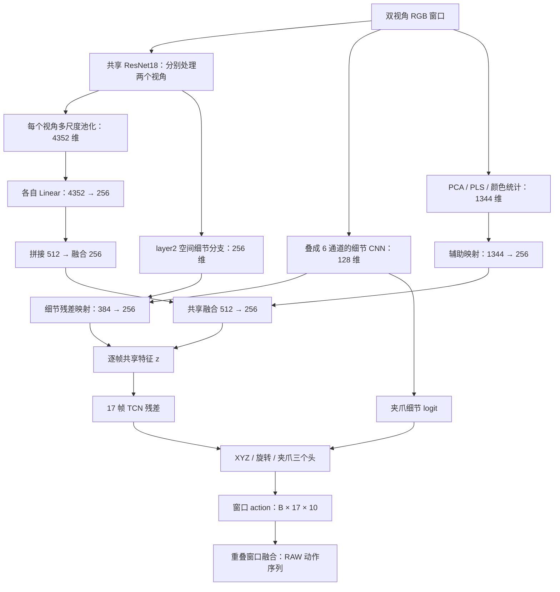

# IDM 架构：视频怎样变成 action

## 1. 模型学的是什么

每个训练样本给出一段双视角视频，以及这段视频对应的末端目标动作。模型输出 10 个数：XYZ 3 维、旋转前两列 6 维、夹爪闭合指令 1 维。

训练时，把预测动作和标签比较，得到位置、旋转、夹爪及相邻帧变化的损失。反向传播将这些损失的梯度传回输出头、TCN、融合层及视觉编码器。AdamW 更新参数，使下一次预测更接近标签。因此，视觉层和动作头共同学习“画面里的变化对应什么动作”，而非人工给每张图片指定一个动作模板。

推理时不输入 GT action、关节角、机械臂 state、时间编号或文本指令。PCA/PLS 的参数虽由 TRAIN 拟合，推理时只处理当前输入的 RGB。

## 2. 输入与总体数据流

- 每个时刻有两个 `256×320` RGB 视角。
- 文件保存为 `256×640`，左半边第三人称，右半边腕部。
- 进入网络前拆成 `[B,17,2,3,256,320]`，两个视角仍分别存在。
- 同时从 RGB 计算 `[B,17,1344]` 辅助特征。
- 输出为 `[B,17,10]`，一次预测窗口内所有位置。



实现入口：[`JointBase / JointFrame / JointAction`](../experiment/source/common.py)。实际实例是 `JointAction`，通过继承组合各分支；不是三个分别训练的模型。

## 3. 主视觉分支与双视角融合

### 3.1 同一套 ResNet18 分别看两个视角

把窗口内的 `B×17×2` 张图片展平到 batch 维，送入同一个 ResNet18。两路使用相同的骨干权重；一张图的卷积不直接读取另一视角的像素。

输入先除以 255，再用 ImageNet RGB 均值/标准差归一化。ResNet 可接收矩形输入，本版保持每视角 `256×320`。

保留三个层级，并用固定平均池化提取多尺度特征：

| 来源 | 每视角特征图 | 池化核 | 展平维度 |
|---|---|---|---:|
| layer1 | `64×64×80` | `16×16` | 1280 |
| layer2 | `128×32×40` | `8×8` | 2560 |
| layer4 | `512×8×10` | `8×10` | 512 |
| 合计 | — | — | **4352** |

较浅层保留边缘、局部位置；较深层提供较大范围的视觉特征。池化仍留下空间网格，而非把所有特征压成一个全局平均数。

### 3.2 两个视角在映射后的特征上融合

第三人称与腕部各有自己的 `Linear(4352,256) → LayerNorm → GELU`。随后拼接为 512 维，再经 `Linear(512,256) → LayerNorm → GELU`：

```text
z_third = P_third(ResNet 多尺度特征)
z_wrist = P_wrist(ResNet 多尺度特征)
z_main  = GELU(LayerNorm(W · concat(z_third,z_wrist) + b))
```

融合层可以同时使用两路信息。例如第三人称更容易呈现整体位置，腕部更容易呈现夹爪附近细节。这是结构上的用途，不能仅凭结构声称它已学出特定物体语义。

**这一步没有 cross-attention，也没有 action token。** action 是后面的数值输出头根据融合特征算出来的。

## 4. 空间细节分支

从 ResNet `layer2` 特征图另取一路：

```text
每视角 [128,32,40]
 → 1×1 Conv：128 → 16
 → AvgPool 4×4：[16,8,10]
 → 两视角一起展平：2560
 → Linear 256 + LayerNorm + GELU
```

它保留较细的空间位置分布，补充主分支较强池化后的信息。参数与主骨干一起训练。

## 5. 夹爪细节 CNN

把同一时刻两张 RGB **沿通道维叠起来**：`[2,3,256,320] → [6,256,320]`，然后缩放为 **高 96、宽 128**。

`96×128` 是单个六通道输入的高和宽；不是两个视角各占 64 像素，也不是 `96×96`。

```text
[6,96,128]
 → Conv3×3 stride2：6→12 → GELU
 → Conv3×3 stride2：12→24 → GELU
 → Conv3×3 stride2：24→32 → GELU
 → AvgPool2：[32,6,8]
 → Flatten 1536 → Linear128 → GELU
```

输出的 128 维特征有两个用途：

1. 与空间细节分支一起补充共享特征，让三个任务都能使用细节信息。
2. 通过 MLP 得到一个夹爪 logit，直接参与夹爪预测。

这里没有人工夹爪框或专门的夹爪检测标注。CNN 从动作监督中学习有用的像素模式。六通道卷积的卷积核可以同时读取两个视角的通道。

## 6. RGB 辅助特征：1344 维

本模型除了神经网络视觉分支，还有固定的传统视觉投影。相关函数在 [`reference_source/`](../experiment/reference_source/)；文件中保留的其他历史回归函数并不参与本模型前向。

### 6.1 灰度与边缘 → PCA/PLS

从原 RGB 的固定区域提取：

- 第三人称区域：灰度与 Sobel 横/纵梯度，共 5376 维。
- 腕部区域：灰度与 Sobel 横/纵梯度，共 2880 维。
- 腕部下方细节区域：灰度 768 维。
- 合计 9024 维。

三个区域分别做 PCA，得到 `128+96+32=256` 维。PCA 提取 TRAIN 图像中主要的变化方向，减少输入规模。

另有两组各 48 维的 PLS 投影：一组用 TRAIN XYZ 作监督，另一组用 TRAIN 全部 10 维动作作监督。PLS 提取与动作标签相关的图像变化方向。

基础投影共 `256+48+48=352` 维。投影、均值、缩放仅由 TRAIN 拟合，随后冻结；它们不随 60 个神经网络 epoch 更新，也不会在 TEST 重新拟合。

### 6.2 加入 RGB 特征的邻帧变化

对每条记录内部，保留原特征和两个差分：

```text
v(t)
0.5 × [v(t+1) - v(t-1)]
0.25 × [v(t+2) - 2v(t) + v(t-2)]
```

边界复制最近帧，绝不跨记录取帧。352 维变成 1056 维。这些是图像特征差分，不是以米/秒表示的机械臂速度。

### 6.3 固定颜色区域统计

两个视角各使用三组蓝色 HSV 阈值。经过形态学处理，取最大的候选区域，计算中心、范围、面积、协方差、颜色均值等 16 个数：`2×3×16=96` 维。加相同邻帧差分后为 288 维。

这是一组固定颜色规则，不是通用物体识别器，也不能保证候选区域始终对应板擦。区域不足 3 像素时填零。

最终 `1056+288=1344` 维。用 TRAIN 均值/尺度归一化，再经 `Linear1344→256 + LayerNorm + GELU`。

## 7. 共享融合与 17 帧时序学习

主视觉 256 维与辅助映射 256 维拼接，经过共享融合层得到 256 维。细节 CNN 的 128 维与空间分支的 256 维拼成 384 维，再映射为 256 维，以 0.1 的残差系数加入：

```text
z = Shared(concat(z_main,z_aux)) + 0.1 × Extra(concat(z_fine,z_dense))
```

17 帧的 `z` 经 TCN：

| 层 | 通道 | 卷积核 | 膨胀率 |
|---|---|---:|---:|
| Conv1D 1 | 256→128 | 5 | 1 |
| Conv1D 2 | 128→128 | 5 | 2 |
| Conv1D 3 | 128→256 | 5 | 4 |

前两层后接 GELU；采用对称 padding。输出为 `z_temporal = z + 0.1×TCN(z)`。它使某帧的动作预测能够参考窗口内的前后视觉变化，例如正在接近、握紧或松开。

这也意味着本版不是只看过去帧的实时因果策略。

## 8. 三个 action 输出头

### XYZ

`MLP256→128→3`，输出乘 0.1 后加 TRAIN XYZ 均值，单位为米。没有输出坐标裁剪。

### 旋转

`MLP256→128→6` 输出两个三维向量 `u,v`，再构造正交旋转矩阵：

```text
a = normalize(u)
b = normalize(v - dot(a,v) × a)
c = cross(a,b)
R = [a b c]
```

保存 R 的前两列：`[r11,r21,r31,r12,r22,r32]`。这是 3D 旋转的 6D 连续表示，不是六个独立旋转角；比较姿态时应使用 SO(3) 角度误差。

### 夹爪

```text
closure = sigmoid(fine_logit + 0.1 × closure_residual(z_temporal))
```

细节分支提供局部视觉线索，共享时序分支提供上下文。输出对应本仿真数据的原始目标闭合指令，0 为开、1 为闭。

本版完整 `state_dict` 有 **187 个条目**，包含权重和缓冲区；这不是只有 187 个标量参数。推理严格加载全部条目。

## 9. 窗口融合及 EMA

一条 375 行动作序列按长度 17、步长 8 切为 47 窗；尾部重复末帧保证输入形状，但超出真实序列的输出不参与融合。

同一真实帧可能被几个窗口预测。用 `sin²(π(j+0.5)/17)` 给窗口中心较大权重：

- XYZ、夹爪：加权平均。
- 旋转：先对旋转矩阵加权平均，再用 SVD 投影回合法 SO(3)。

这得到报告主图中的 **RAW**。RAW 已包含重叠窗口融合。

另存 EMA0.5：XYZ/夹爪取当前 RAW 与前一 EMA 各一半；旋转沿 SO(3) 相对旋转走一半。EMA 是输出后的可选处理，不参与训练，也不是主图 RAW。它会引入滞后，本版平均误差反而高于 RAW。

## 10. 哪些组件被训练

| 组件 | 本轮是否更新 |
|---|---|
| ResNet18 卷积及 BN affine 参数 | 是，微调 |
| BN running mean / variance | 否，固定 |
| 两视角映射、主/辅助融合、空间分支 | 是 |
| 细节 CNN、TCN、三个动作头 | 是 |
| PCA / PLS 投影、辅助归一化统计 | 否，复用 TRAIN-only 拟合结果 |
| 颜色阈值与统计公式 | 否，固定规则 |

本模型训练的是这里的视觉动作网络；没有微调 Codex/GPT 本身。
